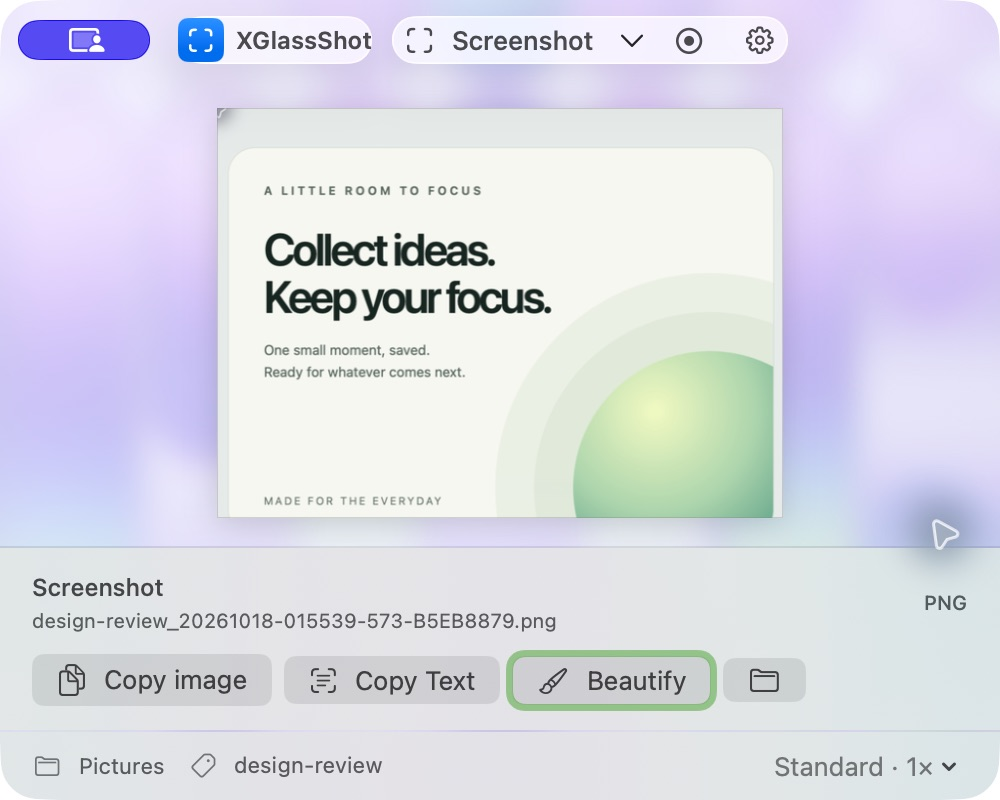
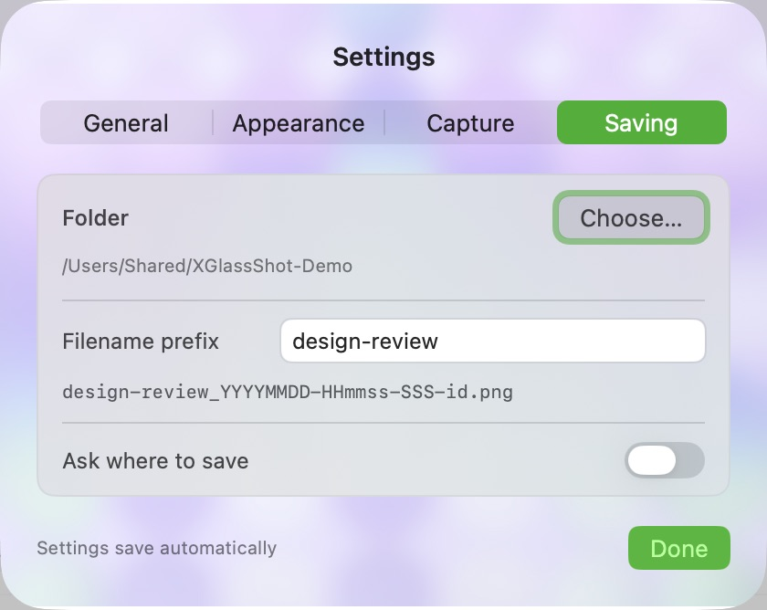
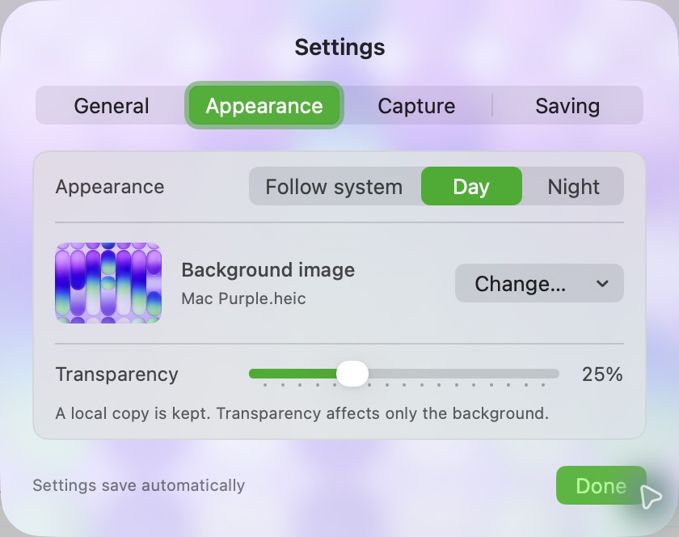

<div align="center">

# XGlassShot

### Capture a moment. Keep your flow.

A small, native screenshot app for macOS.<br>
Your display. Your folder. Your filenames. Everything stays local.

[](#get-xglassshot)
[](LICENSE)
[](https://github.com/xiaolongnk/XGlassShot/actions/workflows/verify.yml)

[Website](https://xiaolongnk.github.io/XGlassShot/) · [Get started](#get-xglassshot) · [CLI & agents](#agent-friendly-cli) · [中文介绍](#中文介绍)

<picture>
  <source media="(prefers-color-scheme: dark)" srcset="docs/images/main-night.png">
  <source media="(prefers-color-scheme: light)" srcset="docs/images/main-day.png">
  
</picture>

*Real app screenshots. Light and dark appearance follow your GitHub theme.*

</div>

## A little capture tool, made for your workflow

| Capture on your terms | Save it your way | Keep it local |
| --- | --- | --- |
| Select an area on the display you choose. Capture at Standard 1× or Retina 2×, or record a video. | Choose a destination and filename prefix, including Unicode and spaces. Automatic saves never overwrite a file. | Copy an image, recognize Chinese/English text with Apple Vision, or style a screenshot. No cloud account required. |

## Your folder. Your filenames. Your workspace.

<table>
<tr>
<td width="50%"></td>
<td width="50%"></td>
</tr>
<tr>
<td><strong>A home for every capture.</strong><br>Keep project screenshots together with a folder and prefix that make sense to you.</td>
<td><strong>Make a little room for your style.</strong><br>Day, Night or Follow System. Add a local background image and tune its transparency.</td>
</tr>
</table>

The workspace stays compact while the image gets the space. Screenshot pixels remain clear as the glass background changes. Prefer the keyboard? The defaults are **⌘⇧2** to capture, **⌘⇧1** to record, and **⌘,** for settings. Change or disable global shortcuts in **Settings → Shortcuts**: click a shortcut and press your new combination, or choose Restore defaults.

## Get XGlassShot

**Free and open source.** No account, advertising, analytics, subscription or in-app purchase.

The free Mac App Store release has been submitted and is awaiting Apple review. [View the App Store listing](https://apps.apple.com/app/id6757980673). Until approval, you can [build from source](#build-from-source).

Requires **macOS 14.6+** for the app, **macOS 14+** for the separate CLI, and Screen Recording permission when capturing. Recordings currently contain video only. Scrolling capture and annotations are not included.

<details>
<summary><strong>Upgrading from GlassCap / screenkit?</strong></summary>

The app, repository and store listing now share one name: **XGlassShot**. The bundle identifier, saved settings, folder grants, recovery files and legacy CLI state paths stay compatible. Existing GitHub links redirect to this repository. Update your remote with:

```sh
git remote set-url origin https://github.com/xiaolongnk/XGlassShot.git
```

The command-line tool is now built from `xglassshot-cli/` and installed as `xglassshot`. An existing `glasscap` installation is left intact; update scripts to the new command when ready.

</details>

## Build from source

Use Xcode 26.2+; the current verified toolchain is Xcode 26.6.

```sh
git clone https://github.com/xiaolongnk/XGlassShot.git
cd XGlassShot
open XGlassShot.xcodeproj
```

Select your own development team and unique bundle identifier in Xcode before running. Apple signing certificates and App Store credentials are not included. For an unsigned compile:

```sh
xcodebuild -project XGlassShot.xcodeproj -scheme XGlassShot -configuration Debug CODE_SIGNING_ALLOWED=NO build
```

For an already configured signing environment, `bash script/build-local.sh /absolute/build-directory` creates and verifies a signed local app. It does not install, upload or publish it.

## Usage

- **⌘⇧2:** choose an area for a screenshot. Drag, then Return to capture or Esc to cancel.
- **⌘⇧1:** choose an area for recording; stop from the app or menu bar.
- **⌘⇧Q:** toggle capture quality.
- **⌘⇧L:** open the compact Saving panel to change the folder and edit the filename prefix. Changes save automatically; Return or Done closes the panel. The footer prefix button opens the same panel.
- **⌘/:** show all keyboard shortcuts, also available from the keyboard button in the footer or Settings → Shortcuts. Quality switches between Standard 1× and Retina 2×; remember **Q = Quality**. The quality dropdown offers both choices directly, and a brief confirmation shows the selected quality and shortcut after each change.
- **⌘,:** open settings. **Saving** controls the folder, filename prefix and optional save panel; **Appearance** controls the theme, image and transparency.
- Use the arrow beside Screenshot to select a specific display. No unavailable-display fallback silently captures another screen.
- Recordings cancelled at the save panel remain in the sandbox's recovery folder. Choose **Recover Recordings…** from the menu to find them.

Permission is requested when you start a capture. Allow XGlassShot in System Settings → Privacy & Security → Screen Recording if requested, then retry. Full Disk Access and Accessibility access are not prerequisites for ordinary capture.

## Agent-friendly CLI

```sh
bash xglassshot-cli/install.sh
xglassshot capabilities
xglassshot screens
xglassshot screenshot --screen 1 --region 100,120,640,400 --quality high --directory "$PWD/captures" --prefix "design-review"
```

Relist displays before selecting an index. Regions are top-left coordinates in points local to that display. Successful commands return JSON and exit 0; capture failures return an error and exit nonzero. The CLI has its own terminal permissions and destinations; it does not silently read sandboxed GUI preferences. See [CLI documentation](xglassshot-cli/README.md) and [AGENTS.md](AGENTS.md).

## Verification

```sh
swift test
swift test --package-path xglassshot-cli
bash script/verify-displays.sh /absolute/evidence-directory
```

The hardware check uses the production selection/capture sources and requires two physical displays plus Screen Recording permission. See [contributing](CONTRIBUTING.md), the [Apple UI review workflow](docs/apple-ui-workflow.md) and [release process](docs/Fastlane.md). Hardware limitations are recorded explicitly rather than inferred from unit tests.

## Privacy, support and license

Captures, OCR, editing, preferences and imported backgrounds stay on your Mac. The app has no network-client entitlement. Imported backgrounds are retained as bounded local copies. The separate GitHub/support website follows its hosting provider's privacy policy.

- [Privacy policy](https://xiaolongnk.github.io/XGlassShot/privacy.html)
- [Support](https://xiaolongnk.github.io/XGlassShot/support.html) and [issues](https://github.com/xiaolongnk/XGlassShot/issues)
- [Security reporting](SECURITY.md)
- [MIT license](LICENSE) and [third-party notices](THIRD_PARTY_NOTICES.md)


## 中文介绍

XGlassShot 是免费开源的 macOS 截图与录屏工具。选择要截取的屏幕和区域，自由设置保存目录与文件名前缀，本地提取中英文文字，或为截图添加背景、留白和圆角。支持白天、夜间、跟随系统，以及背景图片与透明度调整。

无需账号，没有广告、云端 AI、订阅或内购。独立的 JSON 命令行工具方便脚本与 agent 调用。免费商店版本已提交审核；目前也可从源码构建。
